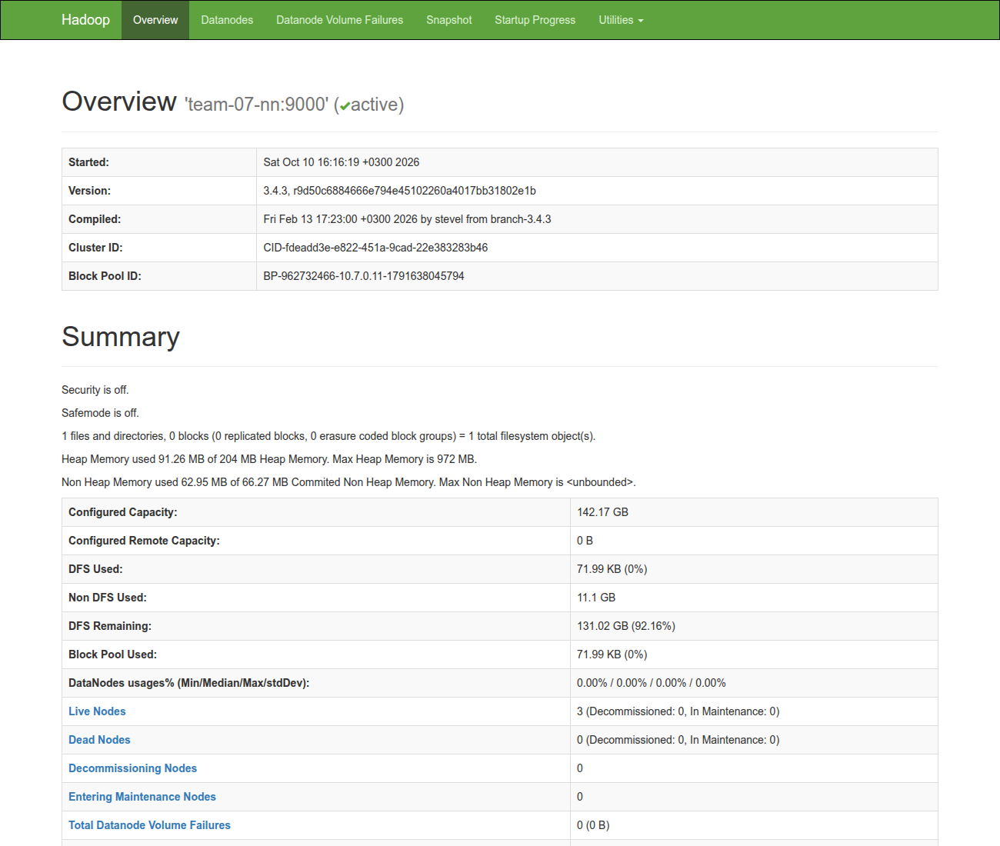
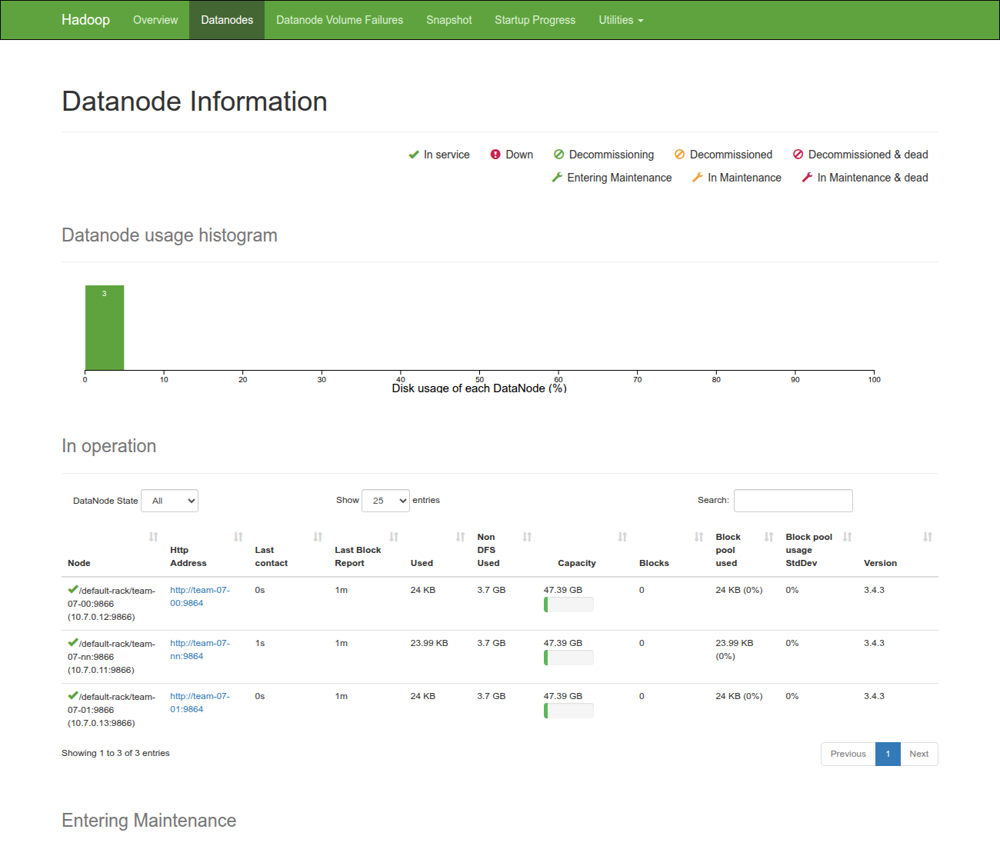

# ДЗ-1.

## Схема кластера

| Узел         | IP        | Роль                                               |
|--------------|-----------|----------------------------------------------------|
| `team-07-en` | 10.7.0.10 | edge-нода                                          |
| `team-07-nn` | 10.7.0.11 | NameNode, Secondary NameNode, DataNode             |
| `team-07-00` | 10.7.0.12 | DataNode                                           |
| `team-07-01` | 10.7.0.13 | DataNode                                           |

- Hadoop 3.4.3 и OpenJDK 11 на Ubuntu 24.04.
- Демоны HDFS работают от отдельного пользователя `hadoop` без sudo.
- Hadoop установлен в `/opt/hadoop`, данные HDFS лежат в `/data/hdfs`.
- Порты: 9000 - RPC NameNode, 9870 - веб-интерфейс NameNode, 9868 - Secondary NameNode, 9864/9866/9867 - DataNode.

## Требования

- **Edge-нода.** Нужен доступ к узлам кластера по SSH под пользователем с sudo без пароля. Пользователь и ключ задаются в `config.env`. Нужны `bash`, `curl`, `envsubst`, `git` и доступ в интернет, чтобы скачать Hadoop.
- **Узлы кластера.** Ubuntu/Debian. Если Java не установлена, скрипт поставит её через `apt`.

## Запуск

```bash
ssh team@<внешний IP edge-ноды>
git clone https://github.com/FynjyBath/hse-data-platforms-2026-team-07.git
cd hse-data-platforms-2026-team-07/HW1
nano config.env
./deploy.sh
```

`deploy.sh` можно безопасно запускать повторно.

## Шаги

### 1. Подготовка узлов `scripts/1_prepare.sh`

### 2. Установка Hadoop `scripts/2_install.sh`

### 3. Конфигурация `scripts/3_configure.sh`

### 4. Запуск `scripts/4_start.sh`

## Проверка `scripts/5_check.sh`

Результат на нашем кластере:

```
=== Процессы HDFS на узлах
team-07-nn: DataNode NameNode SecondaryNameNode
team-07-00: DataNode
team-07-01: DataNode

=== DataNode в отчёте NameNode
Live datanodes (3):
Name: 10.7.0.11:9866 (team-07-nn)
Name: 10.7.0.12:9866 (team-07-00)
Name: 10.7.0.13:9866 (team-07-01)

=== Веб-интерфейс NameNode
http://team-07-nn:9870 отвечает

=== Запись тестового файла (реплик: 3)
реплик блока: 3

=== Ошибки в логах с последнего запуска
team-07-nn: ошибок нет
team-07-00: ошибок нет
team-07-01: ошибок нет

Кластер исправен
```

### Веб-интерфейс NameNode

На вкладке Overview: 3 живых узла, 0 мёртвых.



На вкладке Datanodes все три DataNode в статусе In service:


